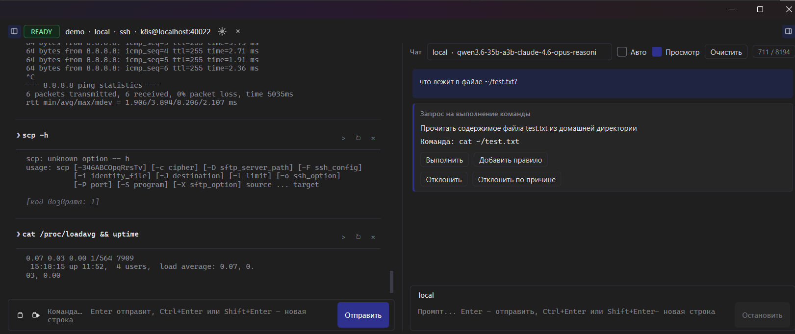
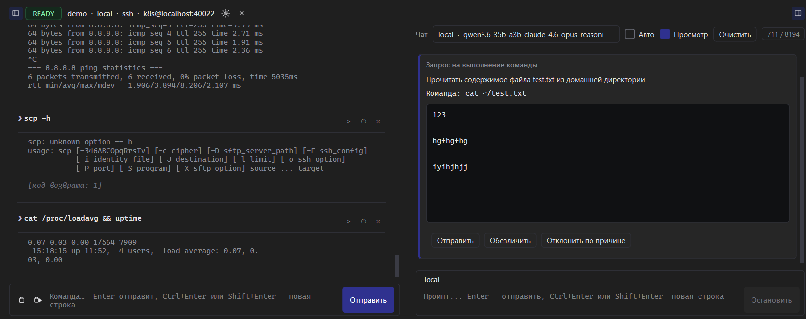
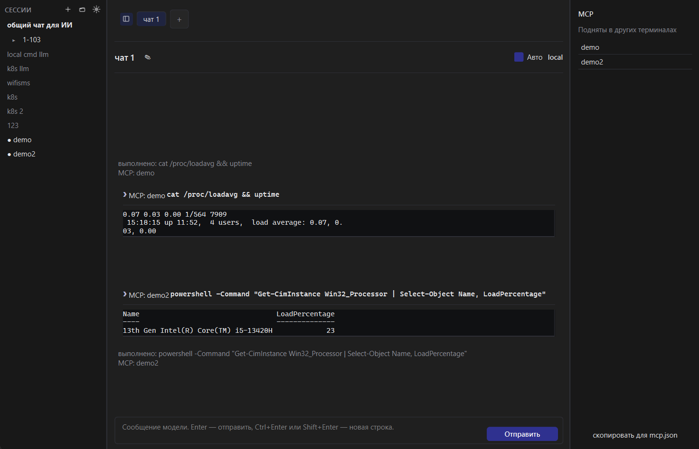

# Renisin

**Человек в цикле для ИИ-агентов в терминале.**

Renisin — это слой контроля между ИИ-агентом и вашим терминалом.
Агент предлагает команду, человек одобряет, смотрит результат вывода и возвращает агенту.
ИИ не может случайно сломать систему или прочитать чувствительные данные.
Для каждого подключения поднимается MCP, позволяя ИИ работать с несколькими устройствами одновременно.

---

## 📑 Оглавление

- [Зачем это нужно](#-зачем-это-нужно)
- [Что умеет Renisin](#-что-умеет-renisin)
- [Как это работает](#-как-это-работает)

---

## 💡 Зачем это нужно

Современные ИИ-агенты умеют выполнять команды в терминале. Именно в этом и проблема.

Дайте агенту неограниченный доступ к shell — и вы отдаёте ему свои SSH-ключи,
`.env`-файлы и продовую базу. Без возможности остановить его на полпути.
Большинство «ИИ-терминалов» *больше доверяют модели*, что *она* не сделает плохого.
Renisin позволяет *ввести контроль со стороны человека*.

Название — игра слов: 人 (**ren**) означает «человек», а **Renisin** читается как
**«ren is ___in___ the loop»** — «человек в цикле».

Renisin переворачивает модель работы:

- ИИ **предлагает** — вы **одобряете**. Ничего не выполняется без вашего `y`.
- Агент видит **только то, что нужно** — и ни байтом больше.
- Агента можно **подключить в любой момент** — и так же в любой момент отключить.
- Он может работать **на всех машинах**, до которых дотягивается ваш терминал.

---

## ✨ Что умеет Renisin

### 🎛 Подключение ИИ-агента в любой момент
Подключайте агента к активной сессии терминала, когда он понадобился, —
а не наоборот. Никаких обёрток, отдельных shell'ов и «копирования из окна в окно».

### 🔒 Никаких утечек, полный контроль
Чувствительные данные не уходят в модель. Каждое действие агента проходит через явное одобрение человеком. 
Вы решаете, что ИИ видит и что ему разрешено.

### 🌐 Один чат — несколько машин
Одна беседа с ИИ может видеть и обслуживать **несколько машин одновременно**.
Используйте пять, десять, двадцать ПК в одном промпте и управляйте ими как одним рабочим пространством.

### 🔌 Сессия как MCP-сервер
Каждая сессия Renisin поднимает **собственный MCP-сервер**. Это значит, что её можно подключить в Claude, Cursor, Codex и т.д.

### 🕳 SSH over SSH
Работает через jump-хосты, цепочки туннелей и вложенный SSH. Куда дотягивается ваш shell — туда дотягивается и Renisin.

---

## 🏗 Как это работает

1. Выполните подключение к необходимому терминалу.
2. Renisin опубликует эту сессию как **MCP-сервер** на локальном сокете, скопировать фрагмент для `mcp.json` можно на странице общего чата.
3. Ваш ИИ-клиент (Claude, Cursor и т. п.) подключается к нему как к MCP-серверу.
4. Когда агент хочет выполнить команду, она сначала **предлагается вам** в интерфейсе.
5. Вы одобряете, редактируете или отклоняете. Выполняются только одобренные команды.
6. MCP может быть неограниченное количество, поэтому агент может работать на нескольких устройствах в рамках одной сессии работы.

---
